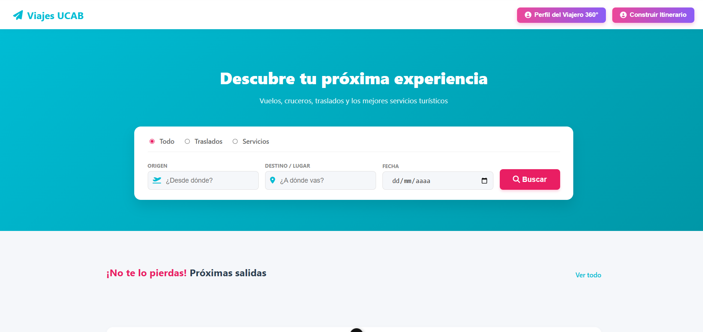
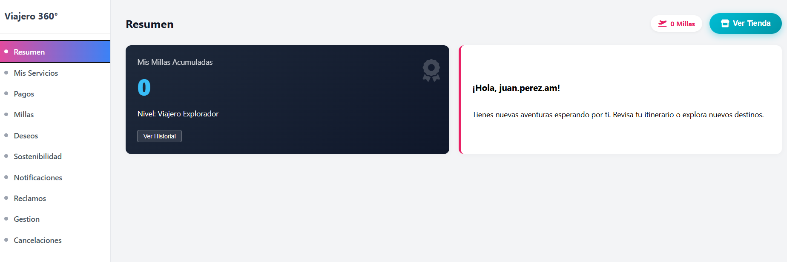
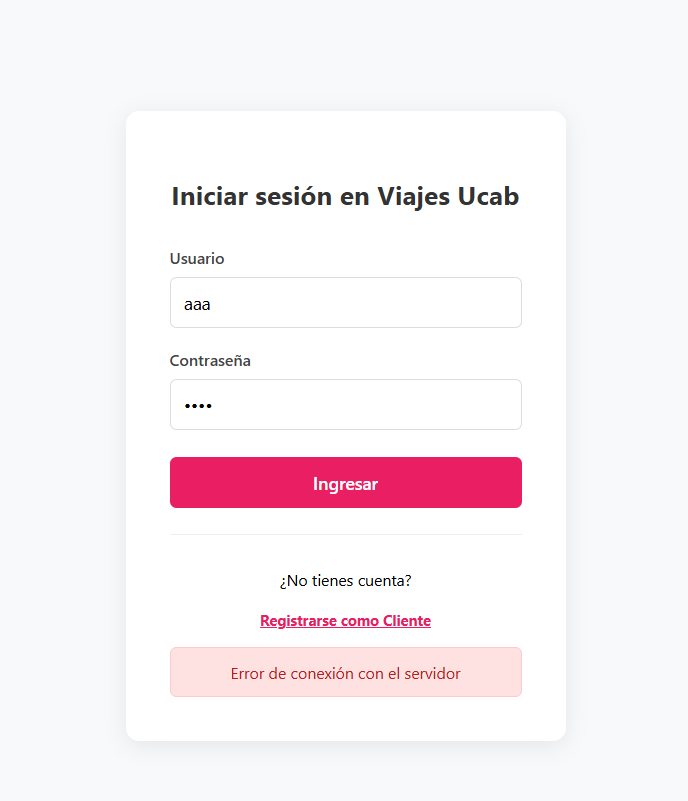
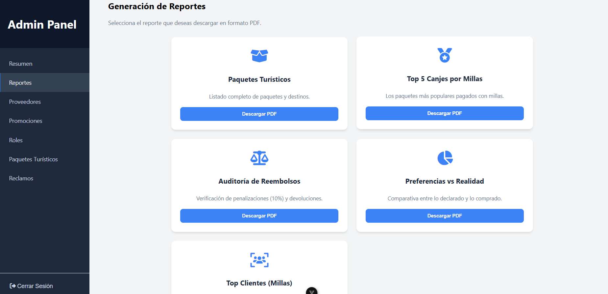

# ✈️ Viajes UCAB: Sistema de Gestión de Turismo y Viajes


Una plataforma integral full-stack para la gestión de paquetes turísticos, reservas, pagos y reportes. Tiene un frontend en Vue 3, una API en Express y una base de datos PostgreSQL con buena parte de la lógica de negocio en procedimientos almacenados y triggers, además de tareas programadas.

## 👥 Equipo y mi rol

Proyecto en equipo de la materia Bases de Datos (UCAB, 6.º semestre). Trabajé como desarrollador full stack:

* **Frontend:** desarrollé las vistas en Vue 3, el enrutamiento y el consumo de la API.
* **Reportes:** implementé la generación de reportes PDF con `jsreport` y `pdfmake`.
* **Backend:** desarrollé varias funcionalidades de la API en Express.

## 🚀 Características Principales

*   **Gestión Integral de Viajes:** Catálogo de paquetes turísticos, vuelos, cruceros, hoteles y actividades.
*   **Procesamiento de Pagos y Reservas:** Sistema de carritos, wishlist y checkout completo.
*   **Automatización de Procesos (Cron Jobs):** Ejecución en segundo plano para aplicar moras diarias automáticamente.
*   **Generación de Reportes PDF:** Integración con `jsreport` y `pdfmake` para la creación de reportes analíticos e itinerarios.
*   **Base de Datos Compleja:** Uso avanzado de PostgreSQL con Triggers, Procedimientos Almacenados y un esquema normalizado.

## 📸 Galería del Proyecto

A continuación, un vistazo a la interfaz principal y los paneles de gestión:

<div align="center">
  
  
</div>
<br>
<div align="center">
  
  
</div>

## 🛠️ Stack Tecnológico

### Frontend
*   **Framework:** Vue 3 (Composition API)
*   **Build Tool:** Vite
*   **Enrutamiento:** Vue Router
*   **Peticiones HTTP:** Axios

### Backend
*   **Entorno:** Node.js
*   **Framework:** Express.js
*   **Reportes:** jsreport & pdfmake
*   **Tareas Programadas:** node-cron

### Base de Datos
*   **Motor:** PostgreSQL (pg)

## ⚙️ Instrucciones de Instalación y Uso (Desarrollo Local)

### 🖼️ Modo "Solo Frontend"
Si no tienes PostgreSQL instalado y solo quieres ver la interfaz, puedes correr el frontend de forma independiente:
1. Abre una terminal en la raíz del proyecto.
2. Instala las dependencias:
   ```bash
   npm install
   ```
3. Ejecuta el servidor de desarrollo:
   ```bash
   npm run dev
   ```
4. Abre `http://localhost:5173` en tu navegador.
*(Nota: Al no estar conectado el backend, la información dinámica de la base de datos no cargará, pero podrás navegar por las vistas y componentes).*

---

### 🖥️ Instalación Full-Stack (Frontend + Backend + DB)

#### Prerrequisitos
- [Node.js](https://nodejs.org/) (v20 o superior recomendado)
- [PostgreSQL](https://www.postgresql.org/) (v14 o superior)

### 1. Configuración de la Base de Datos
1. Abre tu terminal de PostgreSQL (psql) o PgAdmin.
2. Crea la base de datos `viajes_ucab`.
3. Ejecuta los scripts ubicados en la carpeta `db-related-stuff/unified/final` en el siguiente orden:
   - `create.sql`
   - `alter.sql`
   - `insert.sql`

### 2. Credenciales de la base de datos
El backend lee la conexión desde variables de entorno estándar de PostgreSQL (`backend/config/db.js`), así que ninguna contraseña queda guardada en el código:

| Variable | Valor por defecto |
| --- | --- |
| `PGUSER` | `postgres` |
| `PGHOST` | `localhost` |
| `PGDATABASE` | `viajes_ucab` |
| `PGPORT` | `5432` |
| `PGPASSWORD` | *(sin valor, defínela tú)* |

```bash
# Linux / Mac
export PGPASSWORD="tu_contraseña"
# Windows (PowerShell)
$env:PGPASSWORD="tu_contraseña"
```

### 3. Configuración del Backend
1. Abre una terminal y navega a la carpeta del backend:
   ```bash
   cd backend
   ```
2. Instala las dependencias:
   ```bash
   npm install
   ```
3. Inicia el servidor de desarrollo:
   ```bash
   node server.js
   ```
   *El servidor correrá en `http://localhost:3000`.*

### 4. Configuración del Frontend
1. Abre otra pestaña en la terminal en la raíz del proyecto.
2. Instala las dependencias:
   ```bash
   npm install
   ```
3. Inicia la aplicación en modo desarrollo:
   ```bash
   npm run dev
   ```
4. Abre la URL proporcionada por Vite en tu navegador (usualmente `http://localhost:5173`).
